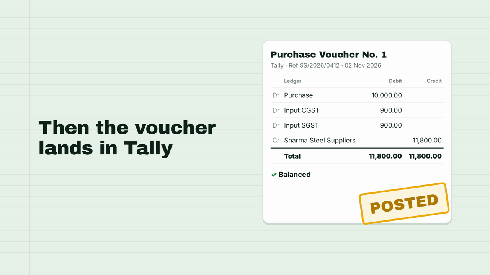

# MunshiG

MunshiG answers your customers on WhatsApp and turns the invoices and payments
they share into Tally entries, but only after you approve each one. It runs
entirely on your own Windows PC with free, local AI. There is no cloud account
and no monthly bill.

[](docs/munshig-demo.mp4)

*Click the picture to watch the demo (43 s, with music; works muted too). It uses the built-in dummy data.*

- **Answers customers** from a knowledge file you write. If the answer isn't
  in the file, it says "let me check and get back to you" and adds the
  question to your follow-up list. It never makes up a price or a promise.
- **Captures money events.** It picks up invoices (PDF or photo), UPI
  screenshots and amounts typed in chat. It reads the party, GSTIN, invoice
  number, date, tax and total, then checks them: GSTIN check digit, totals,
  CGST/SGST versus IGST, duplicates.
- **Asks you once a day.** At 7 pm you get one WhatsApp message listing the
  day's entries. You reply `1P 2S 3R`, and only then does anything reach Tally.
- **Posts to Tally** as Sales, Purchase, Receipt, Payment or Journal-style
  vouchers. It creates new parties when needed, and Tally's answer for each
  entry is reported back to you.

> **Warning:** MunshiG links to WhatsApp as a "linked device" (like WhatsApp
> Web) using the unofficial Baileys library. WhatsApp does not allow automated
> clients and **can restrict or ban the number**. MunshiG only replies to
> people who wrote first, at human pace, and never sends bulk messages. That
> lowers the risk but does not remove it. An official WhatsApp Business API
> option is planned.

## Try it in 2 minutes, no setup

The demo plays one business day with dummy data: chats, invoices, a UPI
screenshot, a quotation and a duplicate. It shows the 7 pm digest and the
owner's reply, then posts to a pretend Tally.

```bash
git clone https://github.com/Nitesh-Khandelwal123/munshig.git
cd munshig
python -m venv .venv
.venv\Scripts\activate            # Windows   (macOS/Linux: source .venv/bin/activate)
pip install -e .
munshig demo
```

To post the demo to **your own Tally** instead (use a test company: the
entries are real vouchers), open TallyPrime with a company named "Demo
Traders", switch on its server (next section), and run:

```bash
munshig demo --tally 127.0.0.1:9000 --company "Demo Traders"
```

Add `--no-edu` if your Tally is licensed. The demo assumes the free
educational mode by default.

## Set it up for a real business

You need a Windows 10/11 PC with 16 GB RAM (8 GB works, more slowly), the
business phone, and TallyPrime. The free educational mode is fine for trying
it out.

**Quick way:** `scripts\setup-windows.ps1` does steps 1 and 2 for you. It
installs Python, Node.js and Ollama with winget, sets up MunshiG, downloads
the AI models (about 9 GB, or skip with `-SkipModels`), adds a `munshig`
command, and runs the demo:

```powershell
git clone https://github.com/Nitesh-Khandelwal123/munshig.git
powershell -ExecutionPolicy Bypass -File .\munshig\scripts\setup-windows.ps1
```

Or by hand:

1. **Install the tools**
   - Python 3.11 or newer ([python.org](https://www.python.org/downloads/)).
     Tick "Add to PATH".
   - Node.js 22 LTS ([nodejs.org](https://nodejs.org/)), for the WhatsApp link.
   - Ollama for local AI ([ollama.com](https://ollama.com/)). OpenJarvis's
     installer also installs it. Then download the models:
     `ollama pull qwen3:4b` and `ollama pull qwen2.5vl:7b`.
2. **Install MunshiG:** in the `munshig` folder, `pip install -e .`, then
   `cd bridge` and `npm ci`.
3. **Switch on Tally's server.** In TallyPrime press F1 (Help) > Settings >
   Connectivity > Client/Server configuration. Set "TallyPrime acts as" to
   **Both**, the port to **9000**, and restart Tally. Keep your company open.
4. **Create your settings:**
   ```bash
   munshig init --business "Your Business" --gstin 27ABCDE1234F1Z5 --owner 919812345678 --company "Your Company" --edu
   ```
   `--owner` is **your personal** WhatsApp number, the only number allowed
   to approve entries. **Only one number?** Use the business number itself:
   MunshiG then talks to you in WhatsApp's "Message yourself" chat. Leave
   out `--edu` if Tally is licensed. This creates
   `munshig.toml` and `knowledge.md` in `%APPDATA%\MunshiG`.
5. **Fill in `knowledge.md`** with your timings, prices, payment details and
   delivery terms. The assistant answers *only* from this file.
6. **Check ledger names.** Run `munshig check`. It lists any ledger MunshiG
   expects that your Tally doesn't have (Sales, Purchase, Input/Output
   CGST/SGST/IGST, Round Off, Cash, Bank, General Expenses). Either create
   them in Tally or change the names in `munshig.toml` to match yours.
7. **Link WhatsApp:** run `munshig link`. On the business phone, open
   WhatsApp > Linked devices > Link a device, and scan the QR code.
8. **Start it:** `munshig run`. Keep the PC on during business hours.

MunshiG starts in **draft mode**: every reply to a customer comes to you
first, and nothing is sent until you approve it. After a week or two, set
`mode = "auto"` under `[assistant]` in `munshig.toml`.

Outside `working_hours` (default `09:00-20:00`) customers get a short "we're
closed" message. Open around the clock? Set `working_hours = "00:00-24:00"`.

**Troubleshooting:** if customers only get "let me check and get back to
you", the local AI isn't answering. On an 8 GB PC this usually means memory
ran out: close heavy apps (browsers, other AI tools), restart Ollama, and
run `munshig check`.

## Replying to MunshiG (from the owner number)

| Send | What happens |
| --- | --- |
| `1P 2S 3R 4X` | Tag entries from the latest digest: **S** sales, **P** purchase, **E** expense, **A** asset, **L** liability, **R** receipt, **PY** payment, **X** ignore. They're posted to Tally right away and you get the result. |
| `3 E Rent` | Tag with a specific ledger (needed for assets and liabilities) |
| `ALL` | Accept every suggested tag, except entries marked "check" |
| `3?` | See entry 3 in full, with the original document |
| `F2 Rs 450 each above 40 pcs` | Send your answer to the customer who asked follow-up F2 |
| `D5` / `D5 <your text>` / `D5 NO` | Send a draft reply as written, send it with your text instead, or drop it |
| `UNDO 3` | Remove entry 3's voucher from Tally (same day only) |
| `DIGEST` | Send the digest now |
| `HELP` | List these commands |

You can also forward a bill to the business number from your own phone, and
it goes into the day's list.

## How entries become vouchers

| Tag | Tally voucher | Debit | Credit |
| --- | --- | --- | --- |
| S | Sales | Customer (total) | Sales, Output GST, round-off |
| P | Purchase | Purchase, Input GST, round-off | Supplier (total) |
| E / A, with a bill | Purchase | Expense or asset ledger, Input GST | Supplier |
| E / A, no bill | Payment | Expense or asset ledger | Cash (or Bank) |
| L | Receipt | Bank | The loan/liability ledger you name |
| R | Receipt | Bank | Customer, against the bill when known |
| PY | Payment | Supplier, against the bill when known | Bank |

Entries post to ledgers only: no stock items yet. Credit/debit notes, cess,
TDS and reverse charge are flagged for you to post by hand. In educational
mode, Tally only accepts dates on the 1st, 2nd or 31st. MunshiG moves the
date to the nearest allowed day in the same month and writes the real date
in the narration (`edu_date_policy = "refuse"` to stop instead).

## Status: what is and isn't verified

Verified with automated tests and the demo:

- Intake, checks, duplicates, the digest and owner commands
- Every voucher rule, against a mock Tally that enforces ledgers, balancing
  and educational-mode dates
- E-invoice QR reading from a PDF

Verified on a real Windows PC with TallyPrime (educational mode) and a phone:

- TallyPrime accepts MunshiG's Sales, Purchase and Receipt vouchers, with
  CGST/SGST or IGST split correctly and new party ledgers created
- Linking WhatsApp by QR code, receiving text messages and sending replies

**Not yet verified:**

- **Tally:** bill-wise allocations in detail, party GSTIN on created
  ledgers, and UNDO deleting by remote ID.
- **WhatsApp:** receiving invoices and screenshots from real customers.
- **AI quality:** how well the local Ollama models read real Indian invoices
  and answer in Hindi and other languages.

Not built yet: voice-note transcription (voice notes become follow-ups), an
OCR cross-check for photos, the local dashboard, the one-click Windows
installer, item-wise invoices, and more than one company per install.

## For developers

```bash
pip install -e ".[dev]"
python -m pytest           # 47 tests, no network, no Tally needed
python scripts/make_samples.py   # regenerate the dummy documents
munshig mock-tally --edu   # a pretend Tally on port 9000
```

| Module | What it does |
| --- | --- |
| `munshig/service.py` | Routes WhatsApp events; replies, digest, retries, reminder, backup |
| `munshig/intake.py`, `extract.py`, `einvoice.py`, `money.py`, `gst.py` | Reading documents and chat into checked entries |
| `munshig/digest.py`, `commands.py`, `approvals.py` | The daily digest and the owner's replies |
| `munshig/posting.py`, `parties.py`, `tally/` | Voucher rules, ledger matching, Tally XML, the mock Tally |
| `munshig/reply.py`, `llm.py` | The customer reply agent and the local AI backends (Ollama, OpenJarvis) |
| `bridge/bridge.mjs` | The Node.js WhatsApp bridge (Baileys), JSON lines on stdin/stdout |

All data stays in `%APPDATA%\MunshiG` (or `~/.munshig`, or `MUNSHIG_HOME`):
settings, the knowledge file, the SQLite database, received media, the
WhatsApp login, and 14 days of daily backups.

## License

Apache 2.0. See [LICENSE](LICENSE). The WhatsApp bridge uses
[Baileys](https://github.com/WhiskeySockets/Baileys) (MIT).
